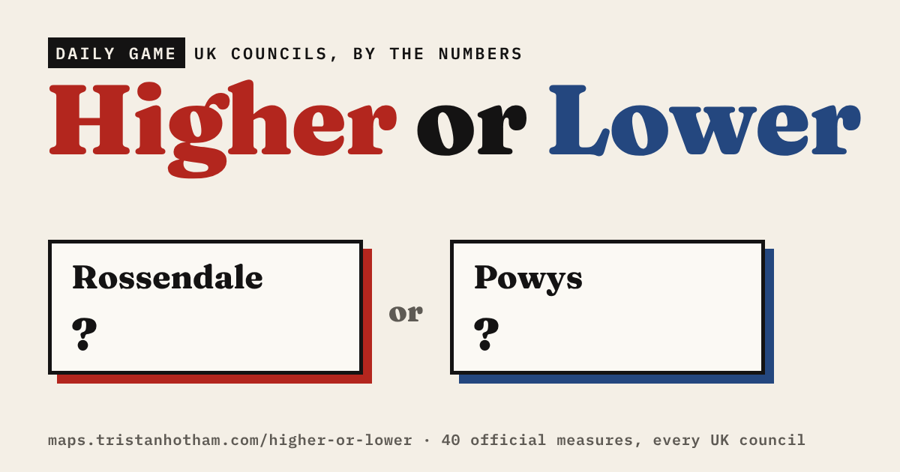

# Higher or Lower: UK places by the numbers

A daily game: two councils, one number, pick the higher. **[Play it](https://maps.tristanhotham.com/higher-or-lower/)**

## How it works

- **Today's 10**: the same ten pairs for everyone each day, one measure per question, with a shareable score.
- **Endless**: keep going until you get one wrong. The pairs get closer as your streak grows. You can stick to one topic, such as Money or Weather.
- Every answer shows both numbers, each council's rank and the source.
- Each council is labelled with its county (or metropolitan county) and region, and a small map zooms to the two councils being compared.
- At least three of each day's ten questions are Just for fun: Druids and witches, sheep farms, distilleries, Victorian post boxes, haunted places and more.

Places are the 359 councils (local authority districts and unitary authorities) of the UK as they stood in April 2023, leaving out the City of London and the Isles of Scilly because they are so small. Councils merged since a dataset was published are combined: Census 2021 counts for Cumbria, North Yorkshire and Somerset are added up, and EU referendum votes are summed for every council merged since 2016. Census measures cover England and Wales only. Pairs too close to call are never asked.

## The 66 measures

**People**

- Population density: Mid-2025 population estimates and Census 2021 land area, ONS, 2025 (316 councils)
- Population: Mid-year population estimates, ONS (via Nomis), 2025 (359 councils)
- Median age: Census 2021, ONS (via Nomis), 2021 (316 councils)
- Born outside the UK: Census 2021, ONS (via Nomis), 2021 (316 councils)
- No religion: Census 2021, ONS (via Nomis), 2021 (316 councils)
- Degree-level qualifications: Census 2021, ONS (via Nomis), 2021 (316 councils)
- Very good health: Census 2021, ONS (via Nomis), 2021 (316 councils)
- Armed forces veterans: Census 2021, ONS (via Nomis), 2021 (316 councils)
- Married or civil partnership: Census 2021, ONS (via Nomis), 2021 (316 councils)
- Retired: Census 2021, ONS (via Nomis), 2021 (316 councils)

**Homes**

- Homes owned outright: Census 2021, ONS (via Nomis), 2021 (316 councils)
- Households with no car: Census 2021, ONS (via Nomis), 2021 (316 councils)
- Detached houses: Census 2021, ONS (via Nomis), 2021 (316 councils)
- Homes with 4+ bedrooms: Census 2021, ONS (via Nomis), 2021 (316 councils)
- No central heating: Census 2021, ONS (via Nomis), 2021 (316 councils)
- Average household size: Census 2021, ONS (via Nomis), 2021 (316 councils)

**Work**

- Working from home: Census 2021, ONS (via Nomis), 2021 (316 councils)
- Cycling to work: Census 2021, ONS (via Nomis), 2021 (316 councils)
- Self-employed: Census 2021, ONS (via Nomis), 2021 (316 councils)
- Long commutes (60 km+): Census 2021, ONS (via Nomis), 2021 (316 councils)

**Money**

- Median full-time pay: Annual Survey of Hours and Earnings (resident analysis), ONS (via Nomis), 2025 (348 councils)
- Household income per person: Regional gross disposable household income, ONS, 2022 (359 councils)
- Median house price: House price statistics for small areas, ONS, 2025 (314 councils)
- House price to earnings ratio: Housing affordability in England and Wales, ONS, 2025 (314 councils)

**High street**

- Pubs and bars: UK Business Counts (local units), ONS (via Nomis), 2026 (359 councils)
- Takeaways: UK Business Counts (local units), ONS (via Nomis), 2026 (359 councils)
- Hairdressers and beauty salons: UK Business Counts (local units), ONS (via Nomis), 2026 (359 councils)
- Hotels: UK Business Counts (local units), ONS (via Nomis), 2026 (359 councils)

**Health**

- Life expectancy (women): Life expectancy for local areas of Great Britain, ONS, 2021–23 (348 councils)
- Life expectancy (men): Life expectancy for local areas of Great Britain, ONS, 2021–23 (348 councils)
- Life satisfaction: Annual personal well-being estimates, ONS (Annual Population Survey); score out of 10, 2022–23 (347 councils)
- Happiness: Annual personal well-being estimates, ONS (Annual Population Survey); score out of 10, 2022–23 (347 councils)

**Politics**

- Leave vote in the EU referendum: EU referendum results, Electoral Commission, 2016 (348 councils)
- EU referendum turnout: EU referendum results, Electoral Commission, 2016 (348 councils)

**Land**

- Area: ONS council boundaries (December 2023), 2023 (359 councils)
- Public rights of way: Council rights of way data via rowmaps.com; The Footpath Capital study, 2026 (303 councils)

**Weather**

- Sunshine: HadUK-Grid climate averages 1991–2020, Met Office (5 km grid, averaged over each council), 1991–2020 (359 councils)
- Rainfall: HadUK-Grid climate averages 1991–2020, Met Office (5 km grid, averaged over each council), 1991–2020 (359 councils)
- July afternoons: HadUK-Grid climate averages 1991–2020, Met Office (5 km grid, averaged over each council), 1991–2020 (359 councils)
- January afternoons: HadUK-Grid climate averages 1991–2020, Met Office (5 km grid, averaged over each council), 1991–2020 (359 councils)

**Just for fun**

- Pagans, Wiccans, witches and Druids: Census 2021, ONS (via Nomis) (religion, detailed), 2021 (316 councils)
- No passport: Census 2021, ONS (via Nomis), 2021 (316 councils)
- Irish passport holders: Census 2021, ONS (via Nomis), 2021 (316 councils)
- English, not British: Census 2021, ONS (via Nomis) (national identity), 2021 (294 councils)
- People with a holiday home: Census 2021, ONS (via Nomis) (second address), 2021 (316 councils)
- Caravan and mobile homes: Census 2021, ONS (via Nomis), 2021 (316 councils)
- Three-car households: Census 2021, ONS (via Nomis), 2021 (316 councils)
- Walking to work: Census 2021, ONS (via Nomis), 2021 (316 councils)
- Breweries: UK Business Counts (local units), ONS (via Nomis), 2026 (359 councils)
- Distilleries: UK Business Counts (local units), ONS (via Nomis), 2026 (359 councils)
- Funeral directors: UK Business Counts (local units), ONS (via Nomis), 2026 (359 councils)
- Spas, saunas and tanning salons: UK Business Counts (local units), ONS (via Nomis), 2026 (359 councils)
- Butchers: UK Business Counts (local units), ONS (via Nomis), 2026 (359 councils)
- Bakeries: UK Business Counts (local units), ONS (via Nomis), 2026 (359 councils)
- Bookshops: UK Business Counts (local units), ONS (via Nomis), 2026 (359 councils)
- Launderettes and dry cleaners: UK Business Counts (local units), ONS (via Nomis), 2026 (359 councils)
- Off-licences: UK Business Counts (local units), ONS (via Nomis), 2026 (359 councils)
- Artists, writers and performers: UK Business Counts (local units), ONS (via Nomis), 2026 (359 councils)
- Taxi firms: UK Business Counts (local units), ONS (via Nomis), 2026 (359 councils)
- Sheep farms: UK Business Counts (local units), ONS (via Nomis), 2026 (359 councils)
- Dairy farms: UK Business Counts (local units), ONS (via Nomis), 2026 (359 councils)
- Queen Victoria's post boxes: OpenStreetMap volunteers' records of royal cyphers; What's the King on Your Postbox? study, 2026 (359 councils)
- Rings of church bells: Dove's Guide for Church Bell Ringers; Ring the Changes study, 2026 (359 councils)
- Earthquakes since 1382: British Geological Survey catalogues; Britain's Earthquakes study, 2026 (348 councils)
- Reportedly haunted places: Wikipedia's lists of reportedly haunted places; Haunted, or Just Old? study, 2026 (348 councils)
- Notable old trees: OpenStreetMap; Where Are Britain's Oldest Trees? study, 2026 (348 councils)

## Files

- `index.html`: the game (one page, no build step)
- `data.json`: every measure for every council, with sources
- `map.json`: simplified council boundaries for the locator map
- `data/councils.csv`: the same as a table, one row per council
- `data/measures.csv`: what each measure is, its source and year
- `code/build_data.py`: builds `data.json` from the downloaded source files
- `code/places_map.py`: adds county and region labels and builds `map.json`

## Sources and licence

Contains public sector information licensed under the Open Government Licence v3.0: Office for National Statistics (Census 2021 via Nomis, mid-year population estimates, Annual Survey of Hours and Earnings, regional gross disposable household income, house price statistics for small areas and affordability ratios, life expectancy for local areas, annual personal well-being estimates, UK Business Counts), Electoral Commission (EU referendum results) and Met Office (HadUK-Grid 1991–2020 averages). Rights of way from council open data via rowmaps.com, as used in [The Footpath Capital](https://maps.tristanhotham.com/footpaths/). Council boundaries: ONS (OGL v3). Just for fun counts also use OpenStreetMap contributors (ODbL), Dove's Guide for Church Bell Ringers, British Geological Survey earthquake catalogues and Wikipedia, via my earlier studies.

Code: MIT. Derived data: CC BY 4.0, keeping the source attributions above.

Dr Tristan Hotham, independent researcher · 2026 · [tristanhotham.com](https://tristanhotham.com)

AI use: built with coding and drafting help from Claude (Anthropic). I reviewed and checked the data and text.
